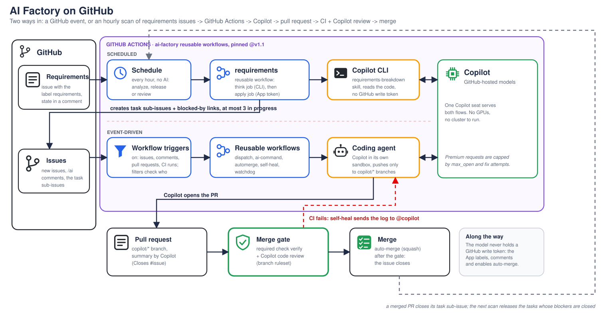
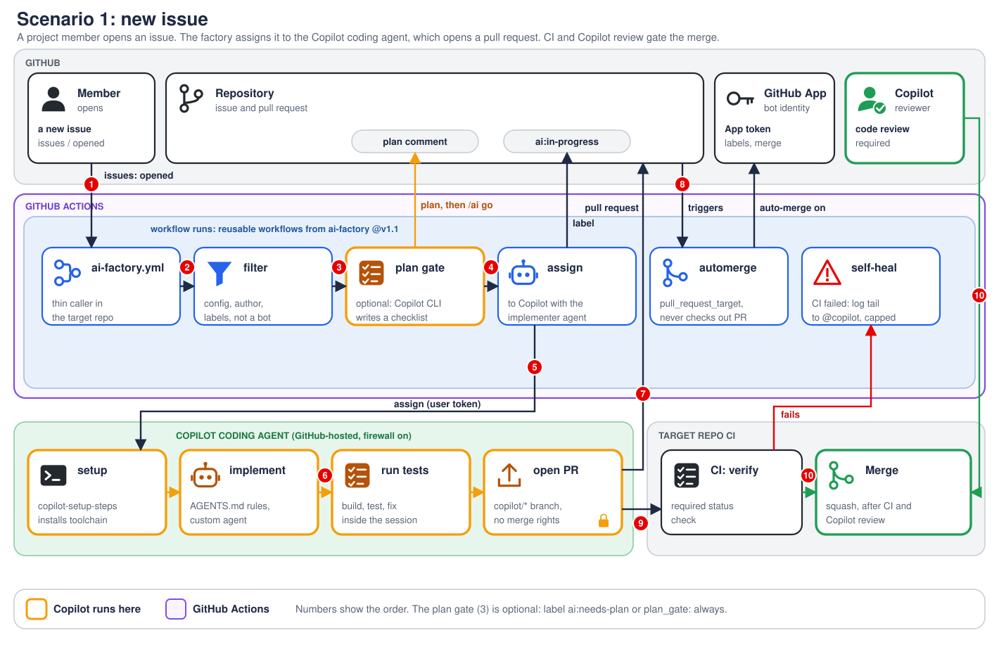
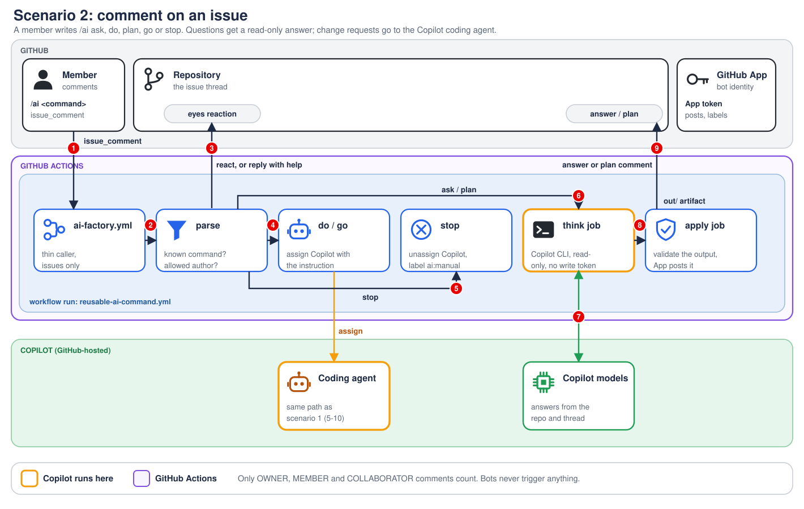
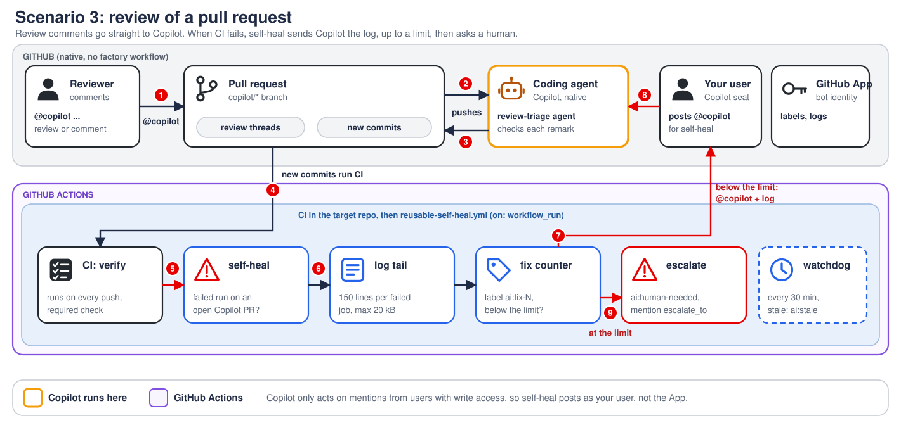

# AI Factory on GitHub + Copilot

A "software factory" that turns GitHub issues, comments and requirements into reviewed, merged pull
requests, built **only** from GitHub-native pieces: GitHub Actions, the Copilot coding agent, Copilot
CLI, Copilot code review, sub-issues, issue dependencies and rulesets.

Inspired by [piomin/ai-software-factory](https://github.com/piomin/ai-software-factory), which does the
same on OpenShift + Tekton + vLLM + OpenCode. Here there is no cluster, no GPU and no webhook endpoint:
every moving part runs inside GitHub.


*The factory at a glance: two ways in (a GitHub event, or the hourly scan of `requirements` issues), the
reusable workflows on GitHub Actions, Copilot (CLI for thinking, coding agent for code), the pull request
behind the merge gate, and the loop back: a merged pull request closes its task sub-issue and the next scan
releases the tasks that were waiting.*

```
GitHub (issue, /ai comment, PR review, CI run)
   │  workflow trigger (no webhook endpoint)
   ▼
ai-factory.yml in the target repo ──► reusable workflow from this repo, pinned @v1.1
                                        └─ filters.ts   (who / what / which event is allowed)
                                           │
              ┌────────────────────────────┘
              ▼
   filter ─► plan gate? ─► assign ─► Copilot coding agent ─► PR ─► CI + Copilot review ─► merge
                │             │              │                       │
          Copilot CLI     user token     own sandbox,          fails: self-heal sends
          writes a plan   (Copilot seat) copilot/* branch      the log to @copilot
```

## What it does

| Workflow | Triggered by | What happens |
|---|---|---|
| `dispatch` | a new or labeled issue (`issues` / `opened`, `labeled`) | Filters the author and labels, optionally posts a checklist plan, assigns the issue to the Copilot coding agent and labels it `ai:in-progress`. |
| `ai-command` | an issue comment `/ai ask\|do\|plan\|go\|stop` | A question gets a read-only answer from Copilot CLI; `do`/`go` assign Copilot with the instruction or the plan; `stop` hands the issue back to humans. |
| native `@copilot` | a pull request review or comment | Copilot reads the conversation, pushes to the same branch and lists anything it did not do (review-triage agent). |
| `automerge` | a Copilot pull request (`pull_request_target`) | Enables auto-merge; the branch ruleset merges it once CI `verify` and the Copilot code review pass. |
| `self-heal` | a failed CI run on a Copilot PR (`workflow_run`) | Sends the log tail to `@copilot`, up to `max_fix_attempts`, then labels `ai:human-needed`. |
| `watchdog` | every 30 minutes | Flags stale drafts and stale in-progress issues, cleans up labels after a merge. |
| `requirements` | hourly, and edits of issues labeled `requirements` | Compares the requirements with the code and creates task sub-issues with "blocked by" links, at most 3 in progress at a time; reviews for gaps when all are closed. |

### Scenario 1: new issue



### Scenario 2: comment on an issue



### Scenario 3: review of a pull request



## How it is organised

| Path | What it is |
|---|---|
| `.github/workflows/reusable-*.yml` | The factory. Reusable workflows (`on: workflow_call`) that target repos call. |
| `src/` | TypeScript logic used by the workflows (filters, config, requirements engine, GitHub client). |
| `test/` | Unit tests (Vitest) for everything in `src/`. |
| `skills/` | Skills used by the Copilot CLI steps (requirements breakdown, review triage). |
| `templates/target-repo/` | Files copied into each repository the factory works on. |
| `docs/` | Plan, architecture, setup guide and implementation specs. |

## Documents

- [docs/PLAN.md](docs/PLAN.md): phases, status, and how the work is split between Claude and Codex
- [docs/ARCHITECTURE.md](docs/ARCHITECTURE.md): flows, components, security model, decisions
- [docs/SETUP.md](docs/SETUP.md): one-time manual setup (Copilot, GitHub App, bot user, rulesets)
- [docs/CONFIG.md](docs/CONFIG.md): per-repository `.github/ai-factory.yml` reference
- [docs/specs/](docs/specs/): implementation specs, one per phase (the input for Codex)
- [AGENTS.md](AGENTS.md): rules for any coding agent working **on this repository**
